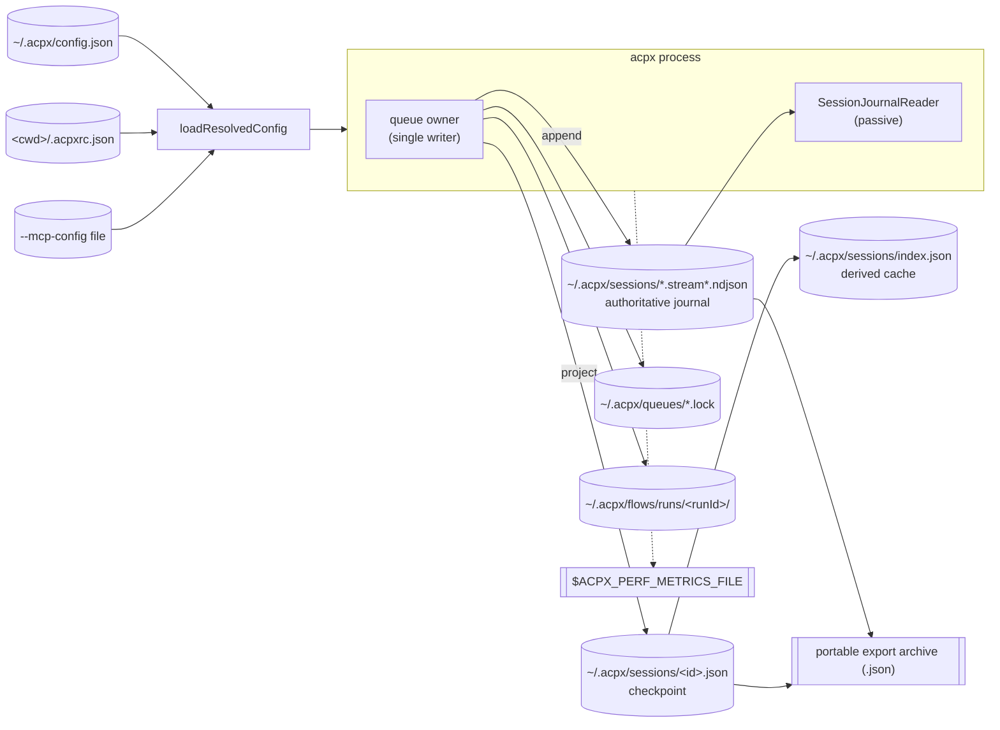
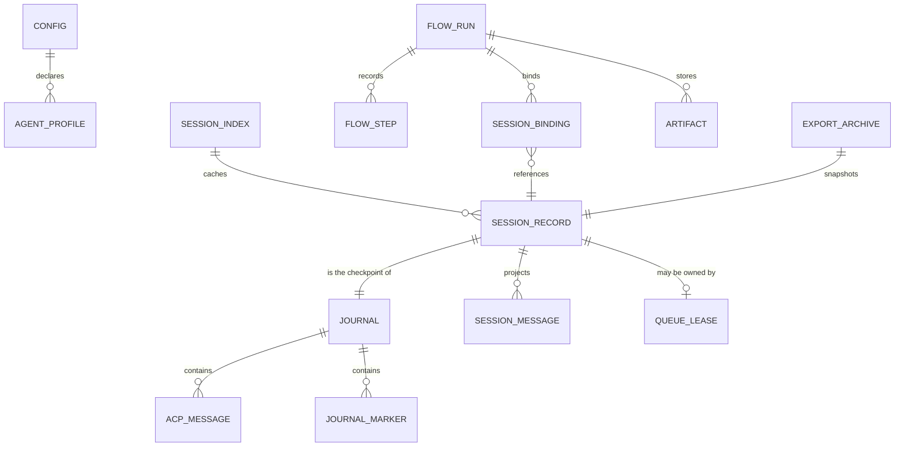
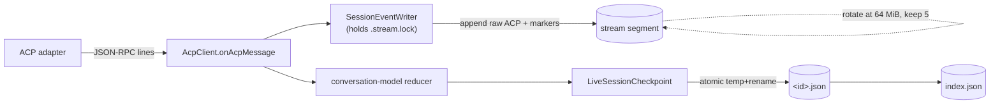
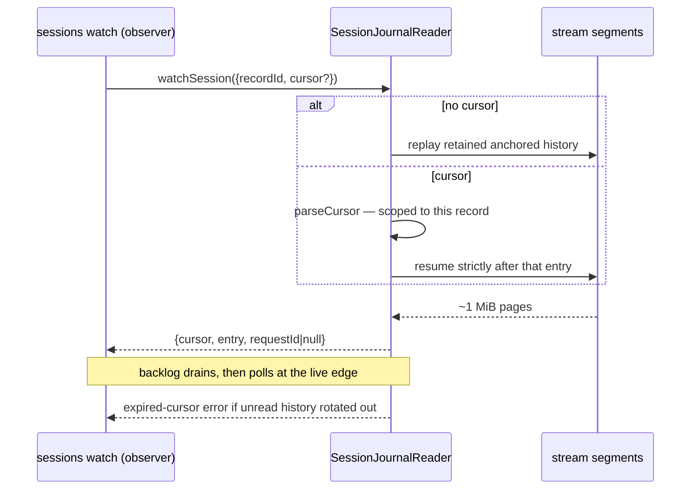

> Source: [openclaw/acpx](https://github.com/openclaw/acpx) (`main` @ `50a47ad`, v0.17.1) · Date: 2026-09-20 · Mode: Explain · Data system: **Hybrid — append-only event log + local JSON document store (no database engine)**
> See also: [System & OOP Architecture](/case-studies/systems/acpx_system_oop_architecture/) · [User-Facing API & UX/DX](/case-studies/systems/acpx_ux_design/)

---

## 1. Overview

`acpx` persists **agent conversations and the machinery around them** on the local filesystem of a single machine, under one home-scoped tree: `~/.acpx/`. There is no database. The data it owns falls into four families: configuration (input), session state (the product), queue-ownership state (coordination), and flow-run bundles (workflow provenance).

The governing decision — stated in `docs/2026-02-27-acpx-session-model.md` and enforced in code — is a **two-tier model**:

> The append-only NDJSON journal is authoritative history. `session.json` is a *derived checkpoint/index*, reconstructible from the stream by deterministic projection. There is no second persisted event protocol.

**Data-system classification — Hybrid, leaning event-sourced.** Evidence:

- **Event/streaming**: `*.stream.ndjson` segments, monotonic sequence anchors, a lock-held single writer (`session/events.ts`), cursor-based passive replay and follow (`session/journal.ts`), segment rotation with retention.
- **Document store**: JSON records read and written whole with schema-on-read parsers (`parseSessionRecord`, `parseQueueOwnerRecord`, `parseIndexEntry`), plus a rebuildable `index.json` cache.
- **Blob / layout**: flow run bundles are a directory tree with a manifest, SHA-256-addressed artifacts, and NDJSON traces.
- **Not relational**: `package.json` has no database driver, ORM, or migration tool. The runtime dependency list is `@agentclientprotocol/sdk`, `@openclaw/fs-safe`, `commander`, `skillflag`, `tsx`, `zod`.

**Tech**: Node `fs/promises`; `@openclaw/fs-safe` for atomic temp-file staging and append-only writes; `zod` for journal-marker and flow-definition validation; NDJSON as the only stream format; UTF-8 JSON everywhere.

---

## 2. Data Landscape

Everything lives under the OS home directory; nothing is written into the user's repository.



| Store | Kind | Holds | Written by | Read by |
|-------|------|-------|-----------|---------|
| `~/.acpx/config.json` | JSON doc, `0600` | Global defaults: agent, permissions, ttl, timeout, format, `agents`, `auth`, `mcpServers` | `config init`, the user | Every invocation (`loadResolvedConfig`) |
| `<cwd>/.acpxrc.json` | JSON doc | Project-level overrides, same shape | The user (never by acpx) | Every invocation |
| `~/.acpx/sessions/<recordId>.json` | JSON doc, `0600`, schema `acpx.session.v1` | Session checkpoint: identity triple, scope, conversation projection, usage, acpx control state | Queue owner / direct runtime | CLI lookup, `status`, `sessions show`, embedders |
| `~/.acpx/sessions/<recordId>.stream[.N].ndjson` | Append-only NDJSON | Raw ACP JSON-RPC messages + local journal markers | `SessionEventWriter` (lock-held) | `SessionJournalReader`, `sessions history/read/watch`, export |
| `~/.acpx/sessions/<recordId>.stream.lock` | Lock file | Single-writer token for the journal | Writer | Writer, export (liveness check) |
| `~/.acpx/sessions/index.json` | JSON doc, schema `acpx.session-index.v1` | Cache of `{file, ids, agentCommand, cwd, name, closed, lastUsedAt}` | `writeSessionIndex` / `rebuildSessionIndex` | `listSessions`, directory-walk lookup |
| `~/.acpx/queues/<hash24>.lock` | JSON doc | `QueueOwnerRecord`: pid, socketPath, heartbeatAt, ownerGeneration, queueDepth, mcp fingerprint | Owner (heartbeat) | Any CLI process deciding whether to submit or spawn |
| `/tmp/acpx-<hash10>/<hash24>.sock` · `\\.\pipe\acpx-<hash24>` | Socket / named pipe | Live IPC — not durable data | Owner | Request clients |
| `~/.acpx/flows/runs/<runId>/` | Directory bundle, `0700` | Manifest, flow snapshot, trace, projections, per-session transcripts, artifacts | `FlowRunStore` | `acpx flow run` resume/inspection, replay viewer |
| Export archive (user-chosen path) | JSON doc, `format_version: 1` | `session.state` + raw ACP `history[]` | `sessions export` | `sessions import` on another machine |
| `$ACPX_PERF_METRICS_FILE` | NDJSON, `0600` | Per-process perf snapshot: counters, timings, gauges, argv, role | `perf-metrics-capture` when env var set | `scripts/perf-report.ts` |

Path derivation lives in exactly four places: `cli/config.ts`, `session/event-log.ts`, `session/queue/paths.ts`, `flows/store.ts`.

---

## 3. Data Models / Schema

### 3.1 Conceptual



The critical relationship is `SESSION_BINDING → SESSION_RECORD`: flows **reference** session records, they never duplicate the transcript. `docs/2026-03-25-acpx-flows-architecture.md` lists "no duplicate transcript store for flow conversations" as a non-goal.

### 3.2 Physical — `acpx.session.v1` (the checkpoint)

Defined by `SessionRecord` in `src/types.ts`, written by `serializeSessionRecordForDisk` in `session/persistence/serialize.ts`.

| Group | Fields (on-disk, snake_case) | Notes |
|-------|------------------------------|-------|
| **Schema** | `schema` | Literal `"acpx.session.v1"` |
| **Identity triple** | `acpx_record_id`, `acp_session_id`, `agent_session_id?` | Three distinct namespaces; values may coincide but semantics differ (see §5) |
| **Scope key** | `agent_command`, `agent_argv?`, `cwd`, `name?` | The tuple that resolves "which session is this directory's session" |
| **Timing** | `created_at`, `last_used_at`, `last_prompt_at?`, `closed_at?` | ISO-8601 |
| **Stream cursor** | `last_seq`, `last_request_id?`, `event_log{active_path, segment_count, max_segment_bytes, max_segments, last_write_at, last_write_error}` | `last_seq` counts ACP messages, matching the journal's `message_sequence` |
| **Lifecycle** | `closed?`, `pid?`, `agent_started_at?`, `last_agent_exit_code?`, `last_agent_exit_signal?`, `last_agent_exit_at?`, `last_agent_disconnect_reason?` | Advisory projection of process state |
| **Capabilities** | `protocol_version?`, `agent_capabilities?` | Snapshot from `initialize` |
| **Conversation projection** | `title?`, `messages[]`, `updated_at`, `cumulative_token_usage`, `cumulative_cost?`, `request_token_usage{}` | Reduced from the journal by `session/conversation-model.ts` |
| **acpx control state** | `acpx{current_mode_id, desired_mode_id, current_model_id, available_models, model_control, available_commands, config_options, session_options, reset_on_next_ensure}` | Local intent + last-known agent state |
| **Provenance** | `imported_from{record_id, cwd_original, exported_by, exported_at}?` | Only on imported records |

`messages[]` is a **tagged union borrowed from Zed's thread schema** — `{"User": {...}}` / `{"Agent": {...}}` / `"Resume"`, with content variants `Text`, `Mention`, `Image`, `Audio`, `Thinking`, `RedactedThinking`, `ToolUse`. The reference implementation it tracks is documented in `docs/2026-02-27-zed-thread-schema.md`. This is why `persisted-key-policy.ts` maintains an explicit `ZED_TAG_KEYS` allowlist exempting those PascalCase tags from the snake_case rule (§7).

### 3.3 Physical — the journal (`*.stream*.ndjson`)

One JSON value per line, two disjoint record families.

**Family A — raw ACP.** Standard JSON-RPC 2.0 shapes, byte-preserved. The contract is negative and strict:

- no added `schema` field on ACP messages
- no synthetic `type` / `stream` / envelope keys
- no renaming of ACP payload fields

**Family B — local markers**, schema `acpx.session.journal.v1`, validated by a `zod` discriminated union in `session/journal.ts`:

| `type` | Payload | Purpose |
|--------|---------|---------|
| `segment` | `record_id`, `sequence`, `message_sequence`, `request_id \| null` | Anchor at the head of each new segment; lets a reader recover position without trusting the checkpoint |
| `turn_started` | `request_id` | Marks the beginning of a turn's output |
| `turn_result` | `request_id`, `result{status: completed\|cancelled\|failed, stopReason?, error?}` | Settled outcome, written **after** finalization |

Two counters run in parallel and mean different things:

- `sequence` — every observable journal entry (ACP + local markers). Backs watch cursors.
- `message_sequence` — ACP messages only. Preserves the original meaning of the checkpoint's `last_seq`.

Anchors themselves do not consume a `sequence`.

### 3.4 Physical — queue lease and flow bundle

`QueueOwnerRecord` (`queue/lease-store.ts`): `pid`, `sessionId`, `socketPath`, `createdAt`, `heartbeatAt`, `ownerGeneration`, `queueDepth`, `sharedRuntime?`, `sessionWatch?`, `mcpConfigPath?`, `mcpConfigFingerprint?`. Heartbeats older than 15 s mark an owner stale.

Flow run bundle (`flows/store.ts`):

```text
~/.acpx/flows/runs/<runId>/
├── manifest.json              # acpx.flow-run-bundle.v1 — paths + session entries
├── flow.json                  # acpx.flow-definition-snapshot.v1 — name/startAt/nodes/edges
├── trace.ndjson               # acpx.flow-trace-event.v1 — seq, at, scope, type, payload
├── projections/
│   ├── run.json               # full FlowRunState
│   ├── live.json              # currentNode, lastHeartbeatAt, statusDetail (written during a step)
│   └── steps.json             # FlowStepRecord[]
├── sessions/<bundleId>/
│   ├── binding.json           # FlowSessionBinding → acpxRecordId / acpSessionId
│   └── events.ndjson          # this run's slice of ACP traffic
└── artifacts/                 # SHA-256-addressed prompt/response/output/stdout/stderr blobs
```

Artifacts are referenced by `FlowArtifactRef{path, mediaType, bytes, sha256}` — content-addressed, so a step record stays small while its payload stays verifiable.

---

## 4. Dataflow & Lineage

### 4.1 Write path (data in motion)



The reducer is the only thing that turns wire traffic into the `messages[]` projection: `recordPromptSubmission`, `recordSessionUpdate`, `recordPromptResponseUsage`, `recordClientOperation`, with `trimConversationForRuntime` bounding in-memory growth.

### 4.2 Read path — passive replay and follow

`SessionJournalReader` deliberately does **none** of the writer's work. Per the session-model contract it "does not acquire a turn lock, write state, start an adapter, refresh activity, answer permissions, or cancel work." It pins file identities before reading, follows appended bytes, and validates continuity between retained anchors.



Cursor failure modes are distinguished rather than collapsed: malformed, foreign (wrong record), expired (rotated out), and future cursors each produce their own error. A slow observer gets an error instead of a silent gap.

### 4.3 One traced lifecycle: prompt → archived

| Stage | Where the data lands |
|-------|----------------------|
| **Submitted** | Prompt text travels as a `submit_prompt` IPC frame (bounded by `ACPX_QUEUE_MAX_REQUEST_BYTES`); it is *not* written to disk by the client |
| **Ingested** | Owner writes `turn_started{request_id}`, then every outbound/inbound ACP message, to the active segment under lock |
| **Projected** | Reducer folds `session/update` notifications into `messages[]`, `cumulative_token_usage`, `request_token_usage[messageId]`; `LiveSessionCheckpoint` writes `session.json` at live and final boundaries |
| **Settled** | `turn_result{request_id, result}` appended after finalization — *not* on receipt of the ACP prompt response |
| **Indexed** | `index.json` rebuilt when the session-file listing changes |
| **Rotated** | At 64 MiB the segment rolls; a new `segment` anchor opens the next file; only 5 segments are retained |
| **Exported** | `sessions export` writes `{format_version: 1, session.state, history[]}` — history is **ACP-only**, local markers filtered out |
| **Imported** | A new `acpx_record_id` is generated; history is written as a fresh active stream; `imported_from` records provenance; watch history restarts from the new record |
| **Purged** | `sessions prune` deletes closed records by `closed_at ?? last_used_at`; `--include-history` also removes `*.stream*` files and the lock |

---

## 5. System of Record & Ownership

| Entity | System of record | Derived / cached copies | Notes |
|--------|------------------|-------------------------|-------|
| **Conversation history** | `*.stream*.ndjson` journal | `session.json.messages[]`; flow `sessions/<id>/events.ndjson`; export `history[]` | Explicitly stated: "`session.json` must be reconstructible from stream + local deterministic projection rules" |
| **Session identity & scope** | `session.json` | `index.json` entries; flow `binding.json`; runtime `AcpRuntimeHandle` | `index.json` is a cache — `loadOrRebuildSessionIndex` discards it when the file listing diverges |
| **Queue ownership** | `~/.acpx/queues/*.lock` + live heartbeat + `kill(pid,0)` | `session.json.pid` and the `owner` projection | ⚠️ Deliberate two-source design, resolved by rule: the owner projection on the record is **advisory only**; the lease plus liveness check is the truth. `status` refuses to report a cached PID unless a live lease ties it to the session. |
| **Agent-side session** | The adapter / coding agent | `acp_session_id`, `agent_session_id` in the record | acpx cannot reconstruct this; a failed `session/load` is surfaced, never silently replaced with a fresh session |
| **Configuration** | `~/.acpx/config.json` + `.acpxrc.json` (+ `--mcp-config`) | `ResolvedAcpxConfig` in memory; `config show` output | Flags override both; acpx only ever *writes* the global file, and only via `config init` with `flag: "wx"` |
| **Flow run state** | `trace.ndjson` (append-only) | `projections/{run,live,steps}.json` | Same journal-and-projection shape as sessions, one level up |
| **Turn outcome** | `turn_result` marker | `turn.result` in the runtime contract; IPC `result` frame | A turn with no result after abrupt owner death is **unknown** — the contract forbids presenting it as completed or safely retryable |

**The one genuinely ambiguous identity** is the triple. The rules from the session model:

- `acpx_record_id` — always required in local storage; the only id guaranteed to exist.
- `acp_session_id` — the wire id; may appear later than record creation.
- `agent_session_id` — harness-native; optional, and the only one safe to hand to a provider CLI. `docs/output-formats.md` warns explicitly: *"Do not assume the `acpxRecordId` can be passed to a native provider CLI."*

---

## 6. Storage & Access

**Access keys.** Sessions are not addressed by primary key from the user's side. The lookup key is the scope tuple `(agentCommand, cwd, name?)`, resolved by `findSessionByDirectoryWalk` — walking up from `cwd` to the git-repository root (`findGitRepositoryRoot`) as the boundary. This is why `acpx` behaves "per repo" without storing a repo id.

**Derived path keys.** Queue paths are content-derived, not stored: `queueKeyForSession = sha256(sessionId)[:24]`, and the POSIX socket directory is `/tmp/acpx-${sha256(homeDir)[:10]}` — which namespaces sockets per user without leaking the home path. Session filenames use `encodeURIComponent(sessionId)` so an id can never escape the sessions directory.

**Write atomicity.** Every whole-document write goes through `writePrivateFile` (`src/state-files.ts`): create the parent at `0700`, stage a temp file **on the same filesystem** via `fs-safe`'s `tempFile`, open `wx` at `0600`, write, then `rename` into place. Last-writer-wins; no persistent locks and no post-publication inode requirement.

**Append ordering.** The journal is the exception — it is append-only under `<recordId>.stream.lock`, with the recovery procedure spelled out: acquire lock → recover next sequence positions from the latest anchor (not the possibly-stale checkpoint) → serialize ACP and local appends through one writer → rotate with an anchor → checkpoint atomically → release. A trailing incomplete record from a dead writer is preserved in place; the next writer seals it by rotating to a fresh anchored segment.

**Retention and paging.**

| Knob | Default | Where |
|------|---------|-------|
| Segment size | 64 MiB | `DEFAULT_EVENT_SEGMENT_MAX_BYTES` |
| Segments retained | 5 | `DEFAULT_EVENT_MAX_SEGMENTS` |
| Watch page | ~1 MiB of encoded records | `WATCH_PAGE_BYTES` |
| IPC message buffer | 10 MiB | `MAX_MESSAGE_BUFFER_SIZE` |
| Queue request size | unlimited unless `ACPX_QUEUE_MAX_REQUEST_BYTES` set | `queue/request-limit.ts` |
| ACP message size | bounded by `ACPX_MAX_ACP_MESSAGE_BYTES` | `acp/ndjson-stream.ts` |
| Terminal output retained | agent `outputByteLimit`, default 64 KiB; host ceiling via `ACPX_TERMINAL_MAX_OUTPUT_BYTES` | `acp/terminal-manager.ts` |
| Owner idle TTL | 300 s (`0` = forever) | `DEFAULT_QUEUE_OWNER_TTL_MS` |
| Stale heartbeat | 15 s | `QUEUE_OWNER_STALE_HEARTBEAT_MS` |

**What makes reads fast.** `index.json` avoids opening every session file for `sessions list` and directory-walk lookup; it is validated strictly (any unparseable entry invalidates the whole cache) and rebuilt by scanning. Corrupt individual records are skipped during a scan rather than failing the listing — a deliberate availability-over-strictness choice at discovery time, in contrast to the *strict* failure policy for passive replay.

---

## 7. Lifecycle & Governance

**Schema evolution.** There is no migration runner. Instead: every persisted document carries an explicit `schema` string (`acpx.session.v1`, `acpx.session-index.v1`, `acpx.session.journal.v1`, `acpx.flow-run-bundle.v1`, `acpx.flow-trace-event.v1`, `acpx.flow-definition-snapshot.v1`) or `format_version` (export archives), and readers validate on read. Version bumps would be handled by rejecting or rebuilding, not by mutating files in place. `AGENTS.md` treats persistence formats as product surface requiring `pnpm run check`.

**Key-casing policy — a checked invariant.** `src/persisted-key-policy.ts` enforces `^[a-z][a-z0-9_]*$` for every key in a serialized session record, with three explicit escape hatches: `ZED_TAG_KEYS` (the PascalCase message tags), `MAP_OBJECT_PATHS` (paths whose keys are data, e.g. `request_token_usage`, `acpx.session_options.env`), and `OPAQUE_VALUE_PATHS` (payloads acpx must not reshape, e.g. `agent_capabilities`, `ToolUse.input`, `acpx.config_options`). `scripts/lint-persisted-key-casing.ts` runs it against a synthetic record as part of `pnpm run lint`. The in-memory TypeScript type stays camelCase; the boundary is `serializeSessionRecordForDisk`.

**Local-state boundary.** The session model forbids local bookkeeping from entering the ACP stream: queue owner pid/health, lock/lease metadata, process lifecycle snapshots, retry counters, diagnostics. The only sanctioned on-disk exception is the journal-marker family (§3.3), and even those are filtered out of ACP-only readers and export archives. `--format json --json-strict` is contract-tested to emit ACP-only lines.

**Retention & deletion.**

- *Soft close* (`sessions close`, `sessions new`): sets `closed`/`closed_at`, terminates the owner, **keeps** the record and history. Auto-resume skips soft-closed records unless one is selected explicitly.
- *Rotation*: bounded automatically — 5 × 64 MiB per session.
- *Prune* (`sessions prune`): the only destructive path. Filters closed records by `--before <date>` or `--older-than <days>` against `closed_at ?? last_used_at`; `--dry-run` previews; `--include-history` additionally deletes `*.stream*.ndjson` and `.stream.lock`. Reports `bytesFreed`.
- Flow run bundles have **no** retention policy in code — they accumulate under `~/.acpx/flows/runs/`.

**Confidentiality controls declared in code.**

| Control | Evidence |
|---------|----------|
| Owner-only file modes | `writePrivateFile` opens `0600`, creates dirs `0700` and `chmod`s them on non-Windows; flow run dirs `0700`; perf capture `0600` |
| Credentials never on argv | Queue-owner options — including `authCredentials` — go to the detached child on **stdin**; the JSON parse error message is deliberately generic because "JSON errors can quote credential-bearing bootstrap bytes" |
| Credentials never persisted to session state | `agentProcessEnv` is documented as "trusted child-only environment overlay; never persisted as session options" |
| Auth resolution order | `ACPX_AUTH_<METHOD_ID>` env var, then `auth.<methodId>` in config — config file created `0600` |
| `_meta` allowlisting | `text_delta` events preserve only `origin`, `kind`, `source` from wire `_meta`; everything else is dropped, and the contract states these are routing hints, **not** authenticated provenance |
| Read-output masking | `--suppress-reads` replaces `fs/read_text_file` payloads and read-like tool output with a placeholder while preserving message shape |
| Perf capture hardening | Symlinks, hardlinked files, and FIFOs are skipped; capture failure never changes exit status |

**What the data *is*, for classification purposes:** prompts, source code read from the working directory, tool output, and model responses. There is no PII/PHI tagging, no encryption at rest, and no field-level classification in the codebase — the protection model is filesystem permissions plus the local-only scope.

---

## 8. Open Questions & External Assumptions

1. **No retention policy for flow run bundles.** `FlowRunStore` creates `~/.acpx/flows/runs/<runId>/` per run with full transcripts and artifacts, and nothing in `src/` deletes them. `sessions prune` covers sessions only. Unbounded growth for anyone running flows regularly; whether that is intentional (provenance is precious) or an oversight is not determinable from the repo.
2. **Backup and multi-machine story is export/import only.** `sessions export`/`import` move one session at a time and explicitly restart watch history under a new record id. There is no sync, no merge, and the design is declared "local-host scoped" — cross-machine queue ownership is a stated non-goal.
3. **Checkpoint rebuild is specified but its trigger is not obvious.** The session model documents a full "replay and recovery" procedure (read all segments → parse → rebuild projection → atomically rewrite `session.json`). Whether that runs automatically on a detected mismatch, or only via a repair path, was not established from the interfaces read.
4. **`agent_capabilities` and `acpx.config_options` are opaque passthrough.** They are exempted from key-casing checks and stored as the adapter sent them. Their shape is the ACP SDK's, and it can change under acpx without a schema bump here.
5. **Retention interacts with watch semantics in a way callers must handle.** A consumer polling `sessions watch` slower than the session produces output will eventually get an expired-cursor error rather than data. The correct client behaviour (re-replay from the start? accept the gap?) is a caller decision the repo does not prescribe.
6. **Segment defaults are not user-configurable.** `max_segment_bytes` and `max_segments` are persisted *into* each record's `event_log` block, implying per-session configurability, but no CLI flag or config key sets them — they always come from the two module constants.
7. **Encryption and multi-user machines are out of the evidence boundary.** The model assumes one OS user owns `~/.acpx`. Shared-host, NFS-home, or encrypted-at-rest requirements are not addressed anywhere in the repo and would need to be settled outside it.
