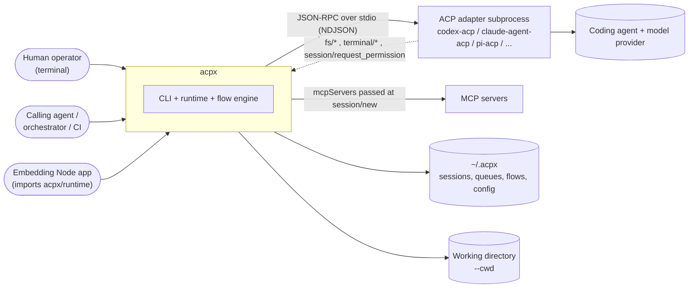
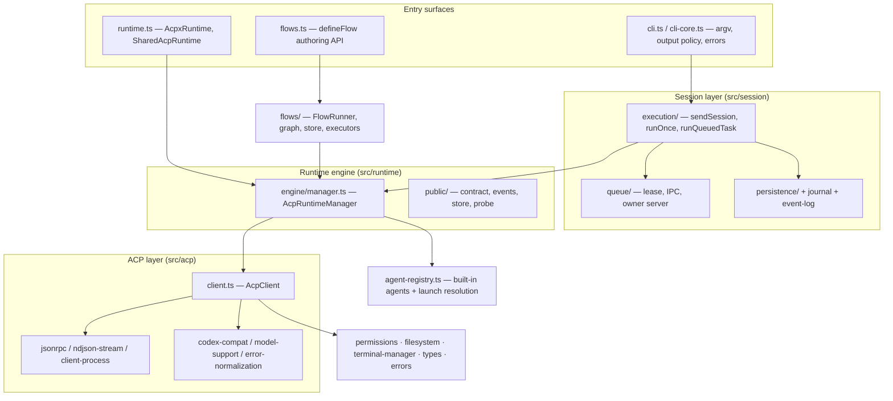
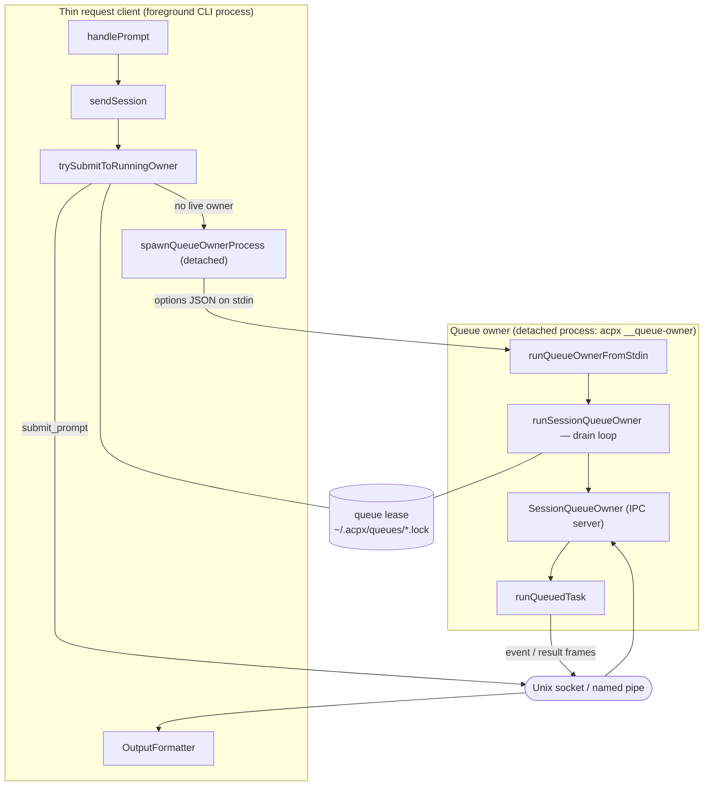
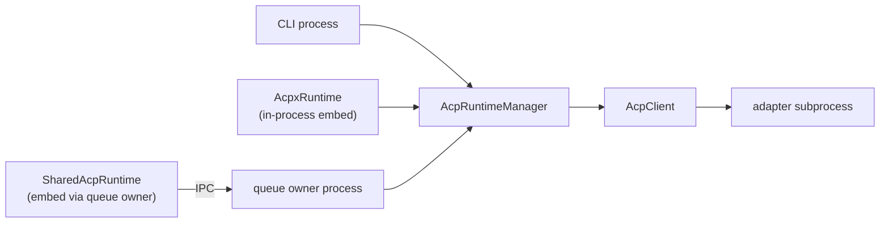
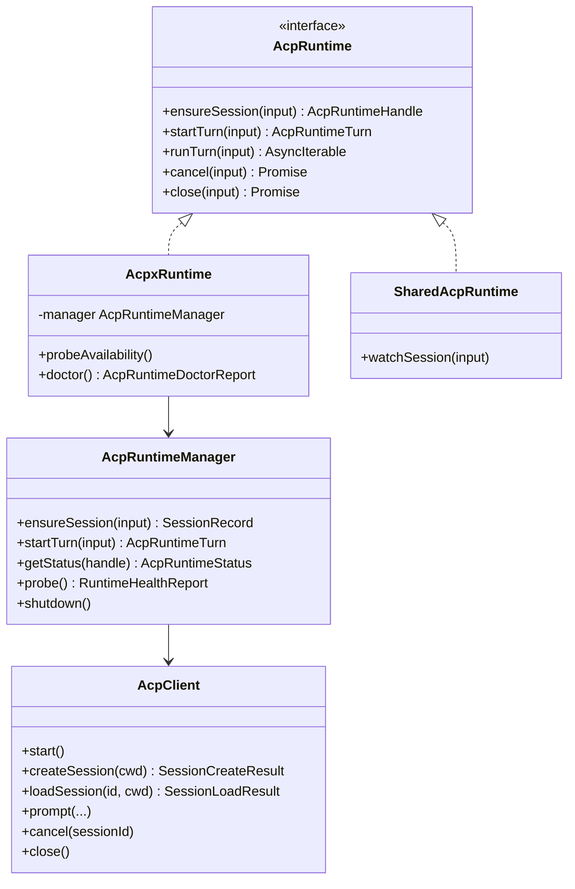
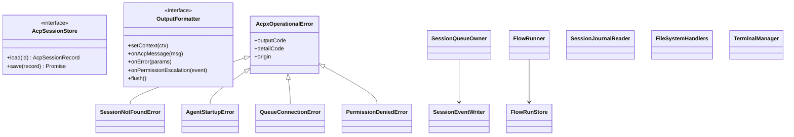
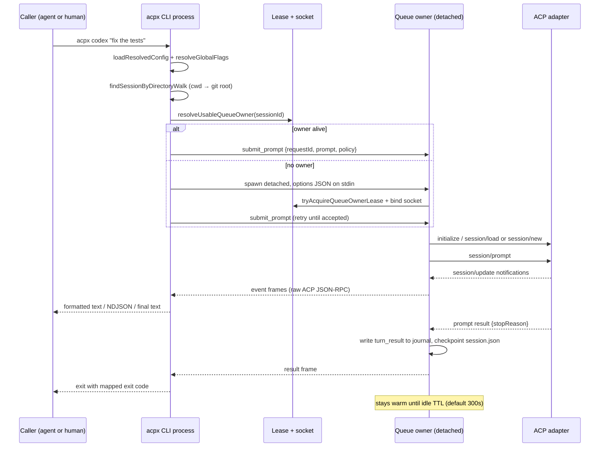
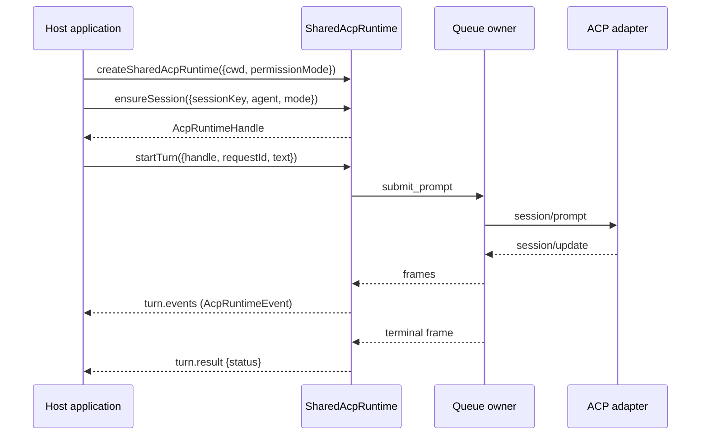
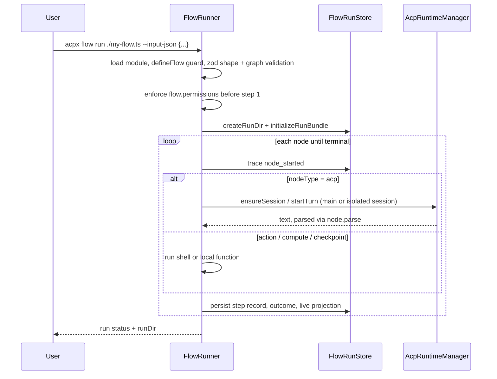

> Source: [openclaw/acpx](https://github.com/openclaw/acpx) (`main` @ `50a47ad`, v0.17.1) · Date: 2026-09-20 · Mode: Explain · Type: **Hybrid** (CLI application + published library)
> See also: [Data Architecture](/case-studies/systems/acpx_data_architecture/) · [User-Facing API & UX/DX](/case-studies/systems/acpx_ux_design/)

---

## 1. Overview

`acpx` is a headless client for the **Agent Client Protocol (ACP)**. It lets one agent, orchestrator, or human drive another coding agent over structured JSON-RPC instead of scraping a PTY. It owns the parts nobody wants to rebuild: adapter process launch, session persistence, prompt queueing, permission policy, and machine-readable output.

Its stated boundary (`VISION.md`) is *"the smallest useful ACP client"* — a client and a backend, not an orchestration framework. The primary user is explicitly another agent; human usability is secondary.

**Type classification — Hybrid.** Evidence from `package.json`:

- **Application**: `"bin": { "acpx": "dist/cli.js" }`, entrypoint `src/cli.ts` with a `#!/usr/bin/env node` shebang and an `isCliEntrypoint()` guard.
- **Library**: an `exports` map publishing four importable surfaces — `.` (`dist/cli.js`), `./runtime` (`src/runtime.ts`), `./flows` (`src/flows.ts`), `./agent-registry` (`src/agent-registry.ts`) — each built with `--dts` by `tsdown`.

The library half is not incidental: `src/runtime/shared.ts:createSharedAcpRuntime()` exists so an embedding application and CLI processes can share **one** local session owner.

**Tech stack**

| Concern | Choice |
|---------|--------|
| Language / runtime | TypeScript (ESM), Node.js `>=22.13.0` |
| Protocol | `@agentclientprotocol/sdk` (`ClientSideConnection`, `ndJsonStream`) |
| CLI parser | `commander` v15 (`enablePositionalOptions`, `passThroughOptions`) |
| Validation | `zod` v4 — flow definition schemas, journal marker schemas |
| Safe file IO | `@openclaw/fs-safe` (`tempFile`, `appendRegularFile`) |
| Skills | `skillflag` — `--skill` handling for the bundled `skills/acpx` |
| Build | `tsdown` (esm + dts), `tsc` for typecheck |
| Quality | `oxlint --type-aware`, `oxfmt`, `node --test` + `c8`, Stryker mutation, Slophammer policy |
| Viewer (example, not published) | React 19 + Vite + `@xyflow/react` + `elkjs` |

---

## 2. System Context <!-- C4 Level 1 -->

The relationship with the adapter is **bidirectional**: `acpx` calls `initialize` / `session/new` / `session/prompt` outbound, and serves `fs/read_text_file`, `fs/write_text_file`, `terminal/*`, `session/request_permission`, and `elicitation/create` inbound (`src/types.ts:ClientOperationMethod`, `src/filesystem.ts`, `src/acp/terminal-manager.ts`). `acpx` is the *client* half of ACP — which is why it is the thing that enforces permissions.

---

## 3. High-Level Structure <!-- C4 Level 2 -->

| Path | Responsibility |
|------|----------------|
| `src/cli.ts` | Shebang entrypoint; broken-pipe handlers; detects the `__queue-owner` role before anything else |
| `src/cli-core.ts` | `main(argv)`: pre-scan argv for `--cwd` / `--format` / `--json-strict` / agent token, load config, build the `commander` program, normalize and emit errors |
| `src/cli-public.ts` | Registers one subcommand per built-in agent, plus the bare `[prompt...]` fallback and the help examples |
| `src/cli/` | Flag parsing & resolution, command handlers, config loading, output formatters (`text` / `json` / `quiet`), `status` and `compare` commands |
| `src/session/execution/` | The CLI-side session lifecycle: `sendSession`, `runOnce` (exec), `runQueuedTask`, `runSessionQueueOwner`, session control |
| `src/session/queue/` | Single-writer ownership: lease file, Unix socket / named pipe IPC, request & response message schemas, request-size limits |
| `src/session/persistence/` | `SessionRecord` read/write/scan, directory-walk lookup, prune, index cache |
| `src/session/journal.ts`, `events.ts`, `event-log.ts` | Append-only NDJSON transcript, segment rotation, passive replay/follow reader |
| `src/runtime/engine/` | `AcpRuntimeManager` — connection pooling, session reuse policy, reconnect + `session/load`, turn execution, status |
| `src/runtime/public/` | The embeddable contract (`AcpRuntime`, `AcpRuntimeEvent`, `AcpSessionStore`), error codes, event reducer, health probe |
| `src/acp/` | `AcpClient` + transport: adapter spawn, NDJSON framing, JSON-RPC errors, adapter compat shims, terminal manager |
| `src/flows/` | Graph definition + validation (`zod`), `FlowRunner`, shell executor, run-bundle store, flow CLI handler |
| `src/agent-registry.ts` | 26 built-in agent profiles; installed-binary vs `npx` launch resolution; alias table |
| `conformance/` | Draft ACP protocol conformance suite (21 cases, `acp-core-v1` profile) — not part of the package |
| `examples/flows/replay-viewer/` | React viewer for persisted flow run bundles — an example, excluded from `files` |

---

## 4. Components <!-- C4 Level 3: inside the session layer -->

The architecturally interesting container is the **session layer**, because it is where the single-writer concurrency model lives.

**How the pieces divide the problem:**

- **Lease** (`queue/lease-store.ts`) is the ownership token — `pid`, `socketPath`, `ownerGeneration`, heartbeat. `resolveUsableQueueOwner()` validates liveness before a caller trusts it; `tryAcquireQueueOwnerLease()` reclaims a stale one.
- **IPC** (`queue/ipc.ts` + `ipc-server.ts`) is a line-delimited JSON request/response protocol with explicit message parsers (`parseQueueRequest`, `parseQueueOwnerMessage`) and a 10 MiB buffer cap.
- **Owner** (`execution/queue-owner-runtime.ts`) is a detached `process.execPath` child spawned with `detached: true`, `stdio: ["pipe","ignore","pipe"]`, receiving its options as a JSON payload on **stdin** (never argv — the payload can carry auth credentials). The submitting CLI keeps only ~4 KB of the owner's early stderr for startup diagnostics, then unrefs the pipe so a `--ttl 0` owner cannot pin the caller alive.
- **Task execution** (`execution/runtime.ts`) runs one turn at a time through `AcpRuntimeManager`, streaming raw ACP messages back as `event` frames and terminating with one `result` frame.

The same `AcpRuntimeManager` is reachable three ways, which is the core reuse story:

---

## 5. OOP & Class Architecture

**Patterns actually in use, and why:**

| Pattern | Where | Why |
|---------|-------|-----|
| **Deep module / facade** | `src/acp/client.ts:AcpClient` (2 546 lines behind `start / createSession / prompt / cancel / close`) | Hides the whole ACP handshake, capability negotiation, adapter quirks, descendant-process cleanup, and permission plumbing behind a small surface. The clearest Ousterhout-style module in the repo. |
| **Interface + two implementations (Bridge/Adapter)** | `AcpRuntime` ← `AcpxRuntime` (in-process) and `SharedAcpRuntime` (over queue IPC) | One contract, two ownership models. An embedding host swaps them without changing call sites. |
| **Strategy** | `OutputFormatter` (`text`/`json`/`quiet` via `createOutputFormatter`); `PermissionPolicy` + `PermissionMode`; `resolveAgent` callback in `FlowRunnerOptions` | Output shape and policy vary independently of the turn machinery. |
| **Registry** | `src/agent-registry.ts:AGENT_DEFINITIONS` → `AGENT_ARGV_REGISTRY`, `BUILT_IN_AGENT_PACKAGES`, `AGENT_ALIASES` | Names are product surface (VISION §4); a table keeps them auditable and the launch strategy in one owner. |
| **Actor / single-writer** | `SessionQueueOwner` + lease + `ownerGeneration` | Exactly one process mutates a session at a time; concurrent callers become clients, not competitors. |
| **Repository** | `session/persistence/repository.ts` + `AcpSessionStore` interface + `createFileSessionStore` | Storage swappable by embedders; CLI uses the file implementation. |
| **Event log + derived projection** | NDJSON journal (authoritative) → `session.json` checkpoint (rebuildable) | See the data lens; the class-level consequence is `SessionEventWriter` (single writer, lock-held) vs `SessionJournalReader` (passive, never writes). |
| **Producer/consumer queue** | `AsyncEventQueue` (`runtime/engine/turn.ts`) | Decouples ACP notification arrival from async-iterator consumption of `turn.events`. |
| **Command** | `commander` command tree in `cli/command-registration.ts` | Each verb is registered once and reused for both the top-level and per-agent namespaces. |
| **Template/hook seam** | `AcpProcessLifecycle` (`onBeforeSpawn` / `onSpawned` / `onSpawnFailed` / `onExit`) | Embedding hosts admit or reject adapter launches without forking the spawn path. |

One notable **anti-pattern avoidance**: `runtime.ts` re-exports ~60 types but almost no behavior — the public library surface is a thin, explicit barrel over `runtime/public/contract.ts`, keeping the published `.d.ts` stable while internals move.

---

## 6. Key Flows

### 6.1 Persistent prompt through a warm queue owner

This is the flow that defines the product. Traced from `src/cli/command-handlers.ts:handlePrompt` → `src/session/execution/queue-owner-runtime.ts:sendSession` → `src/session/execution/runtime.ts:runQueuedTask`.

Two details worth keeping in mind when reading the code:

- The **caller exits as soon as the result frame arrives**; the owner's idle TTL does not block it. That was the explicit goal of `docs/2026-02-25-warm-session-owner-architecture.md`, and `spawnQueueOwnerProcess()` implements it (`child.unref()`, stderr unref).
- Permission requests travel **inbound** during the turn and are resolved inside the owner by `src/permissions.ts:resolvePermissionRequest`, not by the foreground CLI. That is why `--non-interactive-permissions` exists: the detached owner has no TTY.

### 6.2 Embedded library turn

`AcpxRuntime` (in-process) follows the same contract but skips the socket entirely, talking to `AcpRuntimeManager` directly. The contract distinguishes `turn.promptStarted` (transport accepted the prompt) from `turn.result` (finalization and checkpoint settled) — a deliberate split documented in `runtime/public/contract.ts`.

### 6.3 Flow run

Routing is deterministic and lives **outside** the model: `switch` edges keyed on `$.<field>`, or `decisionEdge()` which type-checks that every choice has a case.

---

## 7. Extension Points

`acpx` is extended along a deliberate ladder, lowest rung first (VISION §5 "Fully customizable", §2 "Keep the core small"):

1. **Flags** — every behavior knob is a global flag first (`--agent`, `--permission-policy`, `--mcp-config`, `--model`, `--allowed-tools`, `--system-prompt`).
2. **Declarative config** — `~/.acpx/config.json` then `<cwd>/.acpxrc.json`, merged shallowly (with the `agents` map merging per key). The `agents` entry is the sanctioned way to add a custom ACP server or pin a vendored adapter build; an entry that shares a built-in's name replaces it.
3. **Environment** — `ACPX_AUTH_<METHOD_ID>` for ACP `authenticate` credentials, plus bounded operational knobs (`ACPX_QUEUE_MAX_REQUEST_BYTES`, `ACPX_TERMINAL_MAX_OUTPUT_BYTES`, `ACPX_MAX_ACP_MESSAGE_BYTES`, `ACPX_PERF_METRICS_FILE`).
4. **Flow modules** — user-authored TypeScript imported from `acpx/flows`. The loader rejects a plain exported object that did not come through `defineFlow(...)`, so "is this an intentional flow?" is a checked property, not a convention.
5. **Library embedding** — `acpx/runtime` exposes the `AcpRuntime` interface plus injectable seams: `AcpSessionStore` (swap persistence), `mcpServers` as a resolver function, `sessionPermissions` as a resolver, `onPermissionRequest` / `onElicitation` handlers, and `AcpProcessLifecycle` admission hooks.
6. **Skills** — a bundled `skills/acpx/SKILL.md` shipped in the npm `files` list and surfaced through `skillflag`'s `--skill` handling.

There is no plugin system and no runtime hook registry, which matches the stated non-goal of becoming "a kitchen-sink automation framework". A full treatment of this ladder would be the `extensibility-architecture` lens's job.

---

## 8. Key Abstractions / Glossary

| Term | Meaning |
|------|---------|
| **ACP** | Agent Client Protocol — JSON-RPC 2.0 over stdio between a *client* (acpx) and an *agent* (the adapter). |
| **Adapter** | The subprocess that speaks ACP on behalf of a coding agent, e.g. `@agentclientprotocol/codex-acp`. `acpx` owns which package and version range a built-in name resolves to. |
| **Session record** | The local `SessionRecord` in `~/.acpx/sessions/<id>.json` — a derived checkpoint, not a transport protocol. |
| **Scope key** | The `(agentCommand, cwd, name?)` tuple that identifies a session. Lookup walks up from `cwd` to the git root. |
| **`acpx_record_id`** | Local storage id — always present, and what `text`/`quiet` output prints. |
| **`acp_session_id`** | The session id used on the ACP wire. |
| **`agent_session_id`** | The harness-native id (Codex/Claude/…), present only when the adapter exposes one. |
| **Queue owner** | The detached process holding the lease for one session; the single writer for turns and control operations. |
| **Lease** | `~/.acpx/queues/<hash>.lock` — pid, socket path, generation, heartbeat. Advisory record in `session.json` is a projection, not the truth. |
| **Journal** | Append-only NDJSON transcript: raw ACP messages plus a small set of local `segment` / `turn_started` / `turn_result` markers. |
| **Turn** | One prompt submission and its outcome (`completed` / `cancelled` / `failed`), identified by a caller-supplied `requestId`. |
| **Soft close** | Marking a record `closed` and stopping its owner while retaining history — distinct from `prune`, which deletes. |
| **Flow node kinds** | `acp` (model work), `action` (deterministic runtime-supervised work, incl. `shell`), `compute` (pure transform), `checkpoint` (pause), plus the `decision` helper that composes `acp` + parse + typed routing. |
| **Node outcome** | Control-plane state (`ok` / `timed_out` / `failed` / `cancelled`), kept separate from the step's business output so graphs can route on either. |
| **Run bundle** | `~/.acpx/flows/runs/<runId>/` — manifest, flow snapshot, trace, projections, per-session transcripts, artifacts. |

---

## 9. Open Questions & Notes

Things the code alone could not settle, or where repo artifacts disagree:

1. **Design docs vs. shipped behavior.** `docs/2026-02-25-warm-session-owner-architecture.md` is written as a *target* design. Most of it has landed (detached spawn, lease generation, readiness retry, stdin bootstrap), but its "scope decision" of `ownerIdleTtlSeconds=3600` does not match the shipped default: `DEFAULT_QUEUE_OWNER_TTL_MS = 300_000` in `session/execution/contracts.ts` and `ttl: 300` in the docs. Treat the code as current.
2. **`docs/flows.md` authoring snippet is stale.** It shows `defineFlow({ id, input, steps, edges: [[from, to, predicate]] })`. The real contract in `src/flows/types.ts` and `examples/flows/branch.flow.ts` is `defineFlow({ name, startAt, nodes, edges })` with `decisionEdge(...)` / `switch` edges. The doc labels the snippet "illustrative", but a reader could mistake it for the API.
3. **Built-in adapter materialization is mid-migration.** `docs/2026-04-06-built-in-agent-launch-ownership.md` states the desired end state (acpx-owned adapter cache, launch with `process.execPath`) and explicitly calls the current `npx`/`npm exec` fallback "a compatibility bridge, not the ideal architecture." `resolveInstalledBuiltInAgentLaunch` + `resolvePackageExecBuiltInAgentLaunch` implement both paths today; the cache does not exist yet.
4. **Coverage gating is narrower than it looks.** `pnpm run test:coverage` enforces the 85% thresholds over a specific include list (`flows/{authoring,decision,definition,json,schema,store}`, `runtime/public/**`, `runtime/engine/{manager,status}`) — not all of `src/**`. `AGENTS.md` says so explicitly; do not read it as whole-repo coverage.
5. **Conformance suite status.** `conformance/` is labelled "Draft" with 21 required cases under `acp-core-v1`, run nightly via `.github/workflows/conformance-nightly.yml`. Whether any third-party adapter is certified against it is not determinable from this repo.
6. **Windows parity is partial by design, not by omission.** Named pipes replace Unix sockets, `--agent` raw command strings and legacy `command` config entries are rejected, and terminal kill escalates through `taskkill`. The failure modes are documented; whether they are all covered by CI is not visible here (CI runs `ubuntu-latest` jobs in `ci.yml`).
7. **`AcpClient` is the largest single module** (2 546 lines). It is a coherent deep module rather than a grab bag, but it is also where adapter-specific compatibility accumulates (`codex-compat.ts`, Gemini/Claude startup timeouts, Copilot unsupported errors). Whether that stays a facade or needs an internal adapter-strategy split is a judgement call the repo has not yet made.
