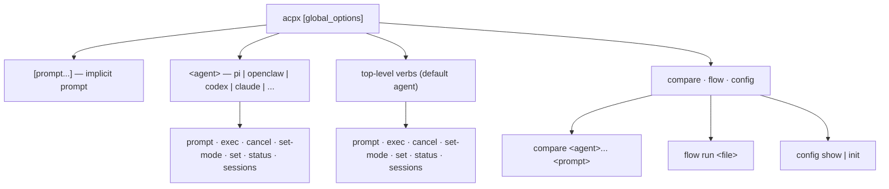
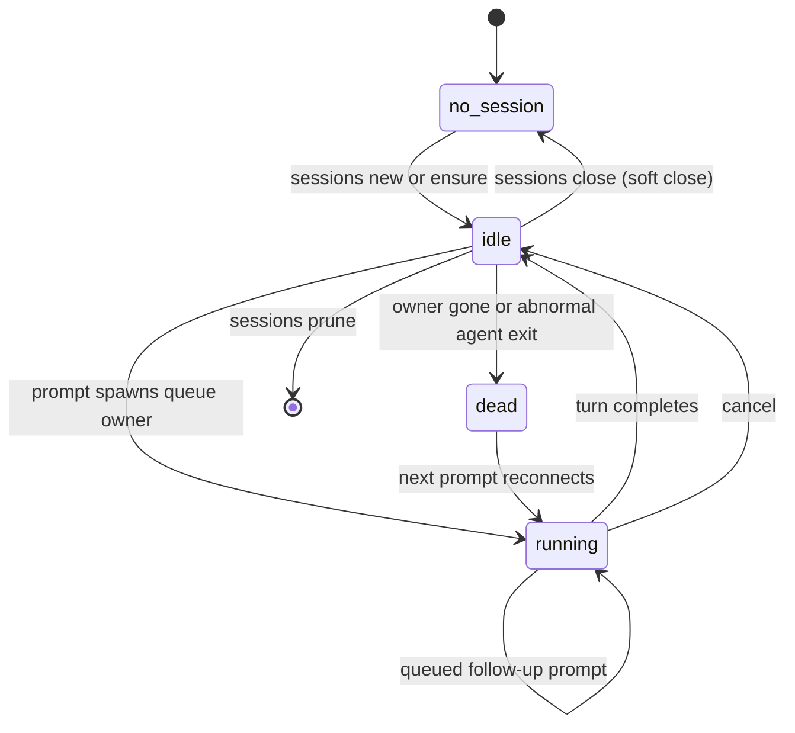

> Source: [openclaw/acpx](https://github.com/openclaw/acpx) (`main` @ `50a47ad`, v0.17.1) · Date: 2026-09-20 · Mode: Explain · Surface: **Hybrid — CLI (primary) + Library/SDK + bundled Agent Skill**
> See also: [System & OOP Architecture](/case-studies/systems/acpx_system_oop_architecture/) · [Data Architecture](/case-studies/systems/acpx_data_architecture/)

---

## Cheat Sheet

```bash
npm install -g acpx@latest                          # Node >= 22.13

acpx codex sessions new                             # create a session scoped to this repo
acpx codex 'find the flaky test and fix it'         # prompt it (persistent, multi-turn)
acpx codex exec 'summarize this repo'               # one-shot, no saved session
acpx codex sessions new --name backend              # parallel named workstream
acpx codex -s backend 'trace the checkout timeout'
acpx codex status                                   # running | idle | dead | no-session
acpx codex cancel                                   # cooperative cancel of the live turn
acpx config show                                    # resolved config + which files loaded

acpx --format json --json-strict codex exec 'review changed files' > events.ndjson
acpx --format quiet codex exec 'one-line summary'   # final assistant text only
acpx --agent './my-acp-server' 'do something'       # any custom ACP server
acpx flow run ./my-flow.ts --input-json '{"task":"..."}'
```

Exit codes to branch on: `0` ok · `1` runtime/agent error · `2` usage · `3` timeout · `4` no session · `5` all permissions denied · `130` interrupted.

---

## 1. Overview

`acpx` gives one caller a single, stable command surface for talking to **any** ACP-capable coding agent — Codex, Claude Code, Pi, OpenClaw, Gemini, Cursor, Copilot and 19 more — without learning each harness's CLI or scraping its terminal UI. Swap `codex` for `claude` and the rest of the command is unchanged.

**Surface type — Hybrid**, with three consumer-facing faces:

| Face | Evidence | Who it's for |
|------|----------|--------------|
| **CLI** | `"bin": {"acpx": "dist/cli.js"}`, a `commander` tree in `cli/command-registration.ts`, a 726-line `docs/CLI.md` | Operators, scripts, CI, and calling agents |
| **Library / SDK** | `exports`: `acpx/runtime`, `acpx/flows`, `acpx/agent-registry`, all built with `--dts` | Node applications embedding ACP sessions |
| **Agent Skill** | `skills/acpx/SKILL.md`, shipped in the npm `files` list and surfaced via `skillflag`'s `--skill` | Coding agents that discover acpx at runtime |

**Who the user is.** `VISION.md` is explicit: *"The primary user is another agent, orchestrator, or harness. Human usability still matters, but it is a secondary constraint."* That inverts the usual priority and shows up throughout the surface — see §6.

Not a product surface: the React **flow replay viewer** under `examples/flows/replay-viewer/` is an example app, excluded from the published `files` list. It is mentioned in §4.3 only because it is how a user inspects a flow run.

---

## 2. Surface Map

### 2.1 Command tree

Every verb exists twice: once at top level (bound to `defaultAgent`, `codex` out of the box) and once under an agent namespace. Global options apply anywhere before the verb.

```mermaid
flowchart TD
    s["sessions"] --> l["list [--local] [--cursor &lt;c&gt;] [--filter-cwd &lt;dir&gt;]"]
    s --> n["new [-s &lt;name&gt;] [--resume-session &lt;id&gt;]"]
    s --> e["ensure [-s &lt;name&gt;] [--resume-session &lt;id&gt;]"]
    s --> c["close [name]"]
    s --> sh["show [name]"]
    s --> h["history [name] [--limit &lt;n&gt;]"]
    s --> rd["read [name] [--tail &lt;n&gt;]"]
    s --> w["watch [-s &lt;name&gt;] [--cursor &lt;c&gt;]"]
    s --> x["export [name] --output &lt;path&gt; [--cwd &lt;dir&gt;]"]
    s --> i["import &lt;archive&gt; [--name &lt;n&gt;] [--cwd &lt;dir&gt;]"]
    s --> p["prune [--dry-run] [--before &lt;date&gt; | --older-than &lt;days&gt;] [--include-history]"]
```





| Touchpoint | What the user does with it |
|------------|---------------------------|
| `acpx <prompt...>` | Prompt the default agent's cwd-scoped session. The default verb. |
| `acpx <agent> <prompt...>` | Same, against a named built-in or an unknown token treated as a raw command |
| `prompt [-s <name>] [--no-wait] [-f <path>]` | Explicit form; `--no-wait` enqueues and returns immediately |
| `exec [-f <path>] [--config-option k=v]` | One-shot in a temporary session; nothing persisted |
| `cancel [-s <name>]` | Cooperative `session/cancel` on the live turn; exits `0` when there is nothing to cancel |
| `set-mode <mode> [-s]` | ACP `session/set_mode` |
| `set <key> <value> [-s]` | ACP `session/set_config_option`; `set model <id>` is the model path |
| `status [-s]` | Local process/queue state — never touches the agent |
| `sessions …` | Full lifecycle: create, list, inspect, watch, move, delete (subtree above) |
| `compare <agent>... '<prompt>'` | One prompt across several agents → a `CompareRow[]` table |
| `flow run <file> [--input-json \| --input-file] [--default-agent]` | Execute a TypeScript workflow module |
| `config show \| init` | Inspect the resolved config (with source paths) or create the global template |
| `--agent '<command>'` | Escape hatch to any ACP server; mutually exclusive with a positional agent |
| `--skill …` | `skillflag` passthrough exposing the bundled `skills/acpx` |

One internal token is reserved and not user-facing: `acpx __queue-owner`, the detached owner entrypoint (`cli.ts`).

### 2.2 Global options

From `src/cli/flags.ts:addGlobalFlags`. Flags always beat config.

| Group | Options |
|-------|---------|
| **Target** | `--agent <command>`, `--cwd <dir>` |
| **Permissions** | `--approve-all`, `--approve-reads`, `--deny-all` (mutually exclusive), `--permission-policy <json-or-file>` (alias `--policy`), `--non-interactive-permissions <deny\|fail>` |
| **Output** | `--format <text\|json\|quiet>`, `--json-strict`, `--suppress-reads`, `--verbose` |
| **Session tuning** | `--model <id>`, `--allowed-tools <list>`, `--max-turns <n>`, `--system-prompt <text>` / `--append-system-prompt <text>`, `--prompt-retries <n>` |
| **Capabilities** | `--no-fs`, `--no-terminal` |
| **Timing** | `--timeout <seconds>`, `--ttl <seconds>` |
| **Tooling** | `--mcp-config <path>`, `--auth-policy <skip\|fail>` |

### 2.3 Built-in agent names

`pi`, `openclaw`, `codex`, `claude`, `gemini`, `cursor`, `copilot`, `antigravity`, `devin`, `droid` (aliases `factory-droid`, `factorydroid`), `fast-agent`, `fx`, `grok-build`, `iflow`, `junie`, `kilocode`, `kimi`, `kiro`, `mcode`, `mux`, `opencode`, `pool`, `qoder`, `qwen`, `trae`, `zeroclaw` — from `src/agent-registry.ts:AGENT_DEFINITIONS`, documented in `agents/README.md`. Any unknown token becomes a raw agent command.

### 2.4 Library surface

| Import | Exports |
|--------|---------|
| `acpx/runtime` | `createAcpRuntime`, `AcpxRuntime`, `createSharedAcpRuntime`, `SharedAcpRuntime`, `createRuntimeStore` / `createFileSessionStore`, `createAgentRegistry`, `inspectAgentModels`, `AcpRuntimeError` + `isAcpRuntimeError`, `RequestedModelUnsupportedError`, `encodeAcpxRuntimeHandleState` / `decodeAcpxRuntimeHandleState`, `DEFAULT_AGENT_NAME`, `ACPX_BACKEND_ID`, plus ~60 types (`AcpRuntime`, `AcpRuntimeEvent`, `AcpRuntimeTurn`, `AcpSessionStore`, `AcpProcessLifecycle`, …) |
| `acpx/flows` | `defineFlow`, node helpers `acp` / `action` / `compute` / `checkpoint` / `shell`, routing helpers `decision` / `decisionEdge`, `FlowRunner`, JSON helpers `extractJsonObject` / `parseJsonObject` / `parseStrictJsonObject`, `flowRunsBaseDir`, flow types |
| `acpx/agent-registry` | Built-in agent names, argv registry, launch resolution, `createAgentRegistry` |

### 2.5 Configuration & docs surfaces

- `~/.acpx/config.json` (global) → `<cwd>/.acpxrc.json` (project) → CLI flags.
- `--mcp-config <path>` replaces `mcpServers` for one invocation.
- `ACPX_AUTH_<METHOD_ID>` env vars for ACP `authenticate`.
- Published docs site at `acpx.sh` (built by `scripts/build-docs-site.mjs`, deployed by `.github/workflows/pages.yml`).

---

## 3. Entry & Onboarding

The smallest real path, straight from `README.md`:

```bash
npm install -g acpx@latest       # or: npx acpx@latest --help
acpx codex sessions new          # prints the record id
acpx codex 'find the slowest test and explain why'
```

Three deliberate onboarding choices:

1. **`sessions new` is required before a persistent prompt.** A bare prompt with no matching session fails with exit `4`, not a silently-created conversation. The README's reason: *"Creating sessions explicitly prevents automation from starting an unexpected conversation."* `sessions ensure` is the idempotent variant for scripts.
2. **`acpx` with no arguments in a TTY prints help** rather than waiting on stdin — but under `--json-strict` the same call is a usage error, because a machine consumer should never receive a help screen (`cli-public.ts`).
3. **The upstream agent must already be installed and authenticated** unless its adapter handles that itself. acpx resolves an installed adapter binary first and falls back to `npx -y <pinned range>`; it does not install agents for you.

`acpx config init` writes `~/.acpx/config.json` only if absent (`flag: "wx"`, mode `0600`) and reports `created: true|false` — safe to run repeatedly.

---

## 4. Key User Journeys

### 4.1 Multi-turn work in a repo (the default journey)

```mermaid
sequenceDiagram
    participant U as User
    participant A as acpx
    participant Ag as Coding agent

    U->>A: acpx codex sessions new --name pr-842
    A-->>U: <record id>
    U->>A: acpx codex -s pr-842 'Review PR #842, list risks'
    A->>Ag: session/prompt
    Ag-->>A: thinking / tool calls / text
    A-->>U: "[thinking] … [tool] Read … [done] end_turn"
    Note over A: process exits; session owner stays warm (TTL 300s)
    U->>A: acpx codex -s pr-842 'Now draft the rollout checklist'
    Note over A,Ag: same conversation, context retained
```

Session lookup walks up from `--cwd` to the git-repository root, so the same command works from any subdirectory of the repo.

### 4.2 Machine-consumed automation

```bash
acpx --format json --json-strict codex exec 'review changed files' \
  | jq -r 'select(.method=="session/update") | .params.update
           | select(.sessionUpdate=="tool_call" or .sessionUpdate=="tool_call_update")
           | [(.status // "-"), (.title // "-")] | @tsv'
```

The contract that makes this safe is negative and load-bearing (`docs/output-formats.md`):

> No acpx-specific event envelope wrapping ACP messages. No synthetic `type` / `stream` / `eventVersion` keys. No payload key renaming.

stdout under `--json-strict` is *only* ACP JSON-RPC, one message per line, in submission order. `compare` is the documented exception — it emits a summarized `CompareRow[]` instead.

### 4.3 Multi-step flow

```bash
acpx --approve-all flow run examples/flows/pr-triage/pr-triage.flow.ts \
  --input-json '{"repo":"openclaw/acpx","prNumber":150}'
```

The flow author writes a graph, not a program:

```ts
import { defineFlow, acp, checkpoint, decision, decisionEdge } from "acpx/flows";

export default defineFlow({
  name: "example-branch",
  startAt: "classify",
  nodes: {
    classify: decision({ choices: ["continue", "checkpoint"], question: ({ input }) => "…" }),
    continue_lane: acp({ prompt: ({ outputs }) => "…", parse: (text) => extractJsonObject(text) }),
    checkpoint_lane: checkpoint({ summary: "needs clarification" }),
  },
  edges: [
    decisionEdge({
      from: "classify",
      choices: ["continue", "checkpoint"],
      cases: { continue: "continue_lane", checkpoint: "checkpoint_lane" },
    }),
  ],
});
```

Run state persists to `~/.acpx/flows/runs/<runId>/` and can be opened in the example replay viewer (`pnpm run viewer:open`).

### 4.4 Embedding in an application

```ts
import { createSharedAcpRuntime } from "acpx/runtime";

const runtime = createSharedAcpRuntime({ cwd: process.cwd(), permissionMode: "deny-all" });
const handle = await runtime.ensureSession({ sessionKey: "reviewer", agent: "pi", mode: "persistent" });
const turn = runtime.startTurn({ handle, requestId: crypto.randomUUID(), mode: "prompt", text: "Summarize the repository" });

await turn.promptStarted;
for await (const event of turn.events) {
  if (event.type === "text_delta") process.stdout.write(event.text);
}
console.log(await turn.result);
```

The payoff is that a terminal can then join the *same* conversation — `acpx pi -s reviewer '…'` — because `sessionKey` maps onto the CLI's session name and both go through the same queue owner.

---

## 5. Interaction & State

### 5.1 Session states the user sees



`status` reports exactly these four words — `running`, `idle`, `dead`, `no-session` — plus session id, agent command, live owner pid, uptime, last prompt time, and last exit code. It is purely local (`kill(pid, 0)` semantics) and safe to poll.

### 5.2 Exit codes

| Code | Meaning |
|------|---------|
| `0` | Success (including `cancel` with nothing to cancel) |
| `1` | Agent / protocol / runtime error |
| `2` | Usage error — bad or conflicting flags, malformed `--agent` |
| `3` | `--timeout` exceeded |
| `4` | No session found for this scope |
| `5` | Every permission request was denied or cancelled, none approved |
| `130` | Interrupted (`SIGINT`/`SIGTERM`); ACP `session/cancel` is sent first |

Code `5` has a precise trigger — at least one request happened *and* all of them ended in denial. If any was approved, the result reflects what the agent returned.

### 5.3 Error surfaces per format

| Format | Where errors go | Shape |
|--------|-----------------|-------|
| `text` | stderr | Message plus one or more `hint: …` remediation lines |
| `json` | stdout | An error event through the JSON formatter; stderr may still carry prose |
| `json` + `--json-strict` | stdout only | Non-JSON stderr suppressed entirely |
| `quiet` | stderr | Exactly one line: `[acpx] error: <CODE> [<DETAIL_CODE>] <message>`, newlines flattened to spaces; stdout stays reserved for assistant text |

Hints are rule-driven, not generic (`src/cli/output/output.ts:getTextErrorRemediationHints`). Examples:

- `AUTH_REQUIRED` → `hint: run 'acpx config show' to locate the active config, then add 'auth.<methodId>' and retry.`
- `TIMEOUT` → `hint: increase '--timeout <seconds>' for long-running prompts, or check whether the agent/provider is stalled.`
- `NO_SESSION` → `⚠ No acpx session found (searched up to <boundary>). Create one: acpx codex sessions new`

Each names the *next command*, not just the failure.

### 5.4 Permission interaction

Three modes — `approve-all`, `approve-reads` (default), `deny-all` — plus a per-tool `PermissionPolicy` (`autoApprove` / `autoDeny` / `escalate` / `defaultAction`) supplied inline as JSON or by file path. When prompting is impossible (no TTY, or a detached queue owner), `--non-interactive-permissions` decides between `deny` and `fail`. A flow can declare `permissions.requiredMode` and `requireExplicitGrant`; the runner then fails **before step 1** and names the flag to add rather than dying mid-run on a write denial.

---

## 6. Information Architecture / API Ergonomics

**The organizing idea is `acpx <agent> <verb>` — agent as namespace.** Every verb is registered identically at top level and under each agent (`src/cli/command-registration.ts:registerSharedAgentSubcommands`), so `acpx codex cancel` and `acpx cancel` differ only in which agent they target. An unknown first token is accepted as an agent name, which is what makes `acpx my-internal-agent 'do X'` work after one config entry.

**Naming is treated as product surface, not convenience.** `VISION.md` §4 uses the built-in name itself as the worked example: *"when `acpx` defines `claude` instead of `claude-code`, that should be an intentional convention, not a casual shortcut."* The practical consequences visible in the surface: only three permission modes; only three output formats; four flow node kinds; a seven-value exit-code table; and a documented ordering policy in `AGENTS.md` that keeps landing docs from becoming a promotional surface for any one harness.

**Consistency checks the surface passes:**

- `-s, --session <name>` means the same thing on every command that takes it, and commander's `optsWithGlobals()` is used so `acpx codex -s foo cancel` works as well as `acpx codex cancel -s foo`.
- Destructive operations require explicit intent: `prune` needs a filter and offers `--dry-run`; `close` is a *soft* close that keeps history; only `--include-history` deletes transcripts.
- Aliases exist where two names are genuinely natural (`--policy` for `--permission-policy`, `--json` for `--format json` on `compare`, `--prompt-file` for `-f`) and conflicting values are rejected rather than silently resolved.
- `--json-strict` fails fast when combined with `--format text` or `--verbose` instead of degrading.

### AX note — when the user is an agent

This surface is designed for a forgetful, text-only reasoner, and it shows:

| AX property | How acpx provides it |
|-------------|----------------------|
| **Self-documenting** | `skills/acpx/SKILL.md` ships inside the npm package and is reachable via `--skill`; `--help` carries 20 worked examples rather than only flag lists |
| **Stable branch points** | Seven documented exit codes plus `OutputErrorCode` / `QueueErrorDetailCode` string enums, so a caller can branch without parsing prose |
| **No envelope tax** | `--format json` emits the raw ACP wire messages — an agent that already understands ACP needs no acpx-specific schema |
| **Token economy** | `--format quiet` returns only final text; `--suppress-reads` masks large file payloads while preserving message shape; `sessions history --limit` and `read --tail` bound transcript reads |
| **Errors that teach** | Every hint names the command to run next; `NO_SESSION` includes the exact `sessions new` invocation and the directory boundary that was searched |
| **Idempotence where it matters** | `sessions ensure` and `config init` are safe to re-run; `requestId` is caller-supplied and *deliberately not* an idempotency key — reusing a live one is rejected |
| **Honest uncertainty** | After a lost connection acpx does not claim a turn completed or auto-retry it; the docs tell the caller to inspect the session before submitting new work |

For an evaluative audit rather than this description, the `ax-interface` lens is the right tool.

---

## 7. Configuration & Customization

**Precedence:** `~/.acpx/config.json` → `<cwd>/.acpxrc.json` → CLI flags. Layers are shallow-merged: missing keys inherit, arrays and objects replace wholesale — except `agents`, where keys merge but each agent object replaces.

| Key | Type | Default | Effect |
|-----|------|---------|--------|
| `defaultAgent` | string | `"codex"` | Agent for top-level verbs |
| `defaultPermissions` | enum | `"approve-reads"` | `approve-all` / `approve-reads` / `deny-all` |
| `nonInteractivePermissions` | enum | `"deny"` | `deny` or `fail` with no TTY |
| `authPolicy` | enum | `"skip"` | When ACP `authenticate` is attempted |
| `ttl` | integer s | `300` | Queue-owner idle TTL; `0` = never shut down |
| `timeout` | number s \| null | `null` | Default `--timeout` |
| `queueMaxDepth` | integer | `16` | Max queued prompts per session |
| `format` | enum | `"text"` | Default `--format` |
| `agents` | object | `{}` | Add or override agent launches |
| `auth` | object | `{}` | ACP auth-method credentials |
| `mcpServers` | array | `[]` | MCP servers passed at session creation |
| `disableExec` | boolean | `false` | Disables `exec` and `compare` |

**Custom agents** use `argv` (required on Windows; the first item is the executable, the rest are literal arguments):

```json
{ "agents": { "my-agent": { "argv": ["./bin/my-acp-server", "acp", "--profile", "ci"] } } }
```

Legacy `{ "command": "…", "args": […] }` migrates only when `command` is an unquoted whitespace-free executable; anything ambiguous is rejected with migration guidance rather than guessed at. The raw `--agent <command>` string form is Unix-only for the same reason.

`acpx config show` prints the fully resolved view **plus** `paths.global` / `paths.project` and a `loaded` flag for each — so "why is this value what it is?" is one command, not a search.

Environment variables are the third tuning layer, mostly bounds rather than behavior: `ACPX_AUTH_<METHOD_ID>`, `ACPX_QUEUE_MAX_REQUEST_BYTES`, `ACPX_TERMINAL_MAX_OUTPUT_BYTES`, `ACPX_MAX_ACP_MESSAGE_BYTES`, `ACPX_PERF_METRICS_FILE`, `ACPX_CLAUDE_INCLUDE_USER_SETTINGS`.

---

## 8. Open Questions & Notes

1. **`sessions read` is implemented but undocumented.** `command-registration.ts` registers `sessions read [name] [--tail <count>]` ("Read full session history"), but it appears in neither the `docs/CLI.md` grammar block nor `skills/acpx/SKILL.md`. An agent reading only the docs will never find it.
2. **The flows authoring example in `docs/flows.md` does not match the API.** It shows `defineFlow({ id, input, steps, edges: [[from, to, predicate]] })`; the real contract is `defineFlow({ name, startAt, nodes, edges })` with `decisionEdge(...)` / `switch` edges, as in `examples/flows/branch.flow.ts`. The doc calls the snippet "illustrative", but it is the first code a flow author meets.
3. **`compare` re-declares global flags locally.** It defines its own `--cwd`, `--approve-all`, `--approve-reads`, `--deny-all`, `--timeout`, `--format`, plus `--json` and `--prompt-file` aliases. Whether that is a deliberate ergonomic concession or drift from the shared global-flag path is not determinable from the code.
4. **`set model <id>` is a documented path with no dedicated subcommand.** `handleSetModel` exists in `command-handlers.ts` but is reached through the generic `set <key> <value>`. Model resolution then depends on adapter capability (a `category: "model"` select control, a custom id, or the legacy `models` metadata), so the same command can succeed or fail purely on which agent is targeted.
5. **Human-facing `text` output is explicitly unstable** — `docs/output-formats.md` says so. The stable contracts are `--format json`, exit codes, and the `quiet` stderr error line. That division is clear in the docs but is not enforced by anything a consumer can check at runtime.
6. **Windows parity is partial and documented as such**, not silently degraded: named pipes instead of Unix sockets, `--agent` raw strings rejected, `.sh` targets require an explicit interpreter, terminal kill escalates through `taskkill`, and sessions created by older releases must be recreated so records persist structured argv.
7. **Pre-1.0 stability caveat is stated once, in the README** (*"Treat its CLI and runtime interfaces as evolving"*), and is not repeated in `docs/CLI.md` or `SKILL.md` — the two places an automated consumer is most likely to read.
